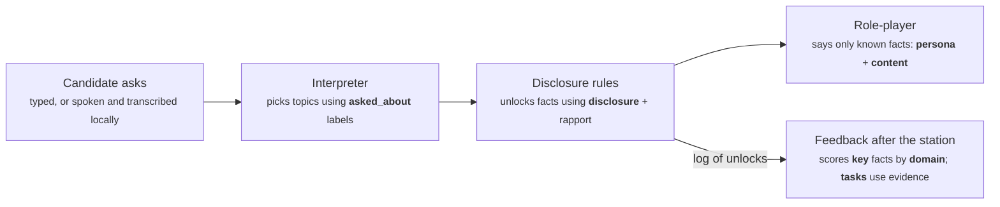

# Adding or editing a CASC station

Last updated 2026-10-14. For the whole process, including the 3D character, voice,
evaluation data and training, follow [NEW-STATION-PROCESS.md](NEW-STATION-PROCESS.md); this
guide is the reference for writing the YAML.

## Overview

A station is one YAML file in `data/cases/`, named after its ID (for example `data/cases/alcohol-history.yaml`). Adding a file adds the station; the app reads cases on every request, so a saved change appears after a page refresh with no restart.

The file holds everything the simulator knows: the exam framing the candidate sees, the character, and a list of hidden **facts**, each with rules for when it may be revealed. During an interview the system decides which facts each question asks about, reveals only those its rules allow, and gives the role-play model nothing else. After the station, feedback is calculated from which facts were revealed and when.



The disclosure rules are the gate: the role-player never sees a fact until they unlock it, so a station is only as good as its labels and fact wording.

This guide is for anyone writing or changing a station. It assumes you can edit a text file and run commands from the project folder. Every case is original fiction and is marked not clinically validated.

**Without editing YAML.** The case editor creates, copies or revises a case in forms, with a rule preview of its disclosure behaviour, and exports the YAML plus a review sheet. Start the development server with `AUTHORING_ENABLED=true npm run dev` and open `http://127.0.0.1:3105/authoring`. It never changes `data/cases/`: an export is integrated by a developer through [NEW-STATION-PROCESS.md](NEW-STATION-PROCESS.md). See [CASE-EDITOR-PLAN.md](CASE-EDITOR-PLAN.md).

## Ground rules

These come from the project's rules (`AGENTS.md`) and the source registry; the schema enforces the ones marked *checked*.

- **Original fiction only.** No real patients, no RCPsych station scripts, question banks or eLearning content. Write every case yourself.
- **Follow the pinned blueprint.** Stations use the March 2023 CASC syllabus and blueprint: its skills, subdivisions, specialties and timings. *Checked.*
- **Not clinically validated.** Every case carries `clinically_validated: false`; the schema rejects anything else until a clinician review process exists. *Checked.*
- **The case is the only source of truth.** The character can say only what the case states. If a detail matters to the station, it must be a fact; if it is not written down, the character will deflect.
- **One station per file, named after its ID.** `id: alcohol-history` lives in `alcohol-history.yaml`. *Checked.*

## Create a new station

Copy the existing case closest to yours and change it; that is quicker and safer than starting blank. To have an LLM draft it, use the prompts in [LLM-STATION-PROMPT.md](LLM-STATION-PROMPT.md).

1. **Choose the blueprint slot.** Pick the skill (history, examination or management), its subdivision and the specialty from the field reference below. Management stations get 240 s reading time; history and examination stations 90 s (or 240 s if set in the morning session).
2. **Copy a case.** For example `cp data/cases/alcohol-history.yaml data/cases/eating-disorder-history.yaml`.
3. **Set the identity.** Change `id` to match the file name, set `version: 0.1.0` and a short `title`.
4. **Write the candidate instructions.** Two to four sentences: who the candidate is, who they are meeting, the task, and anything excluded ("Do not discuss management"). The candidate sees this during reading time.
5. **Write the persona.** Role, name, age, a one- or two-line background, speech style, affect, and the `opening_statement` the character says when the interview begins. Keep facts out of the background: anything clinically meaningful belongs in `facts`.
6. **Write the facts.** Usually 8 to 13. Follow the next section closely; this is where station quality is decided.
7. **Add tasks** (optional): candidate actions such as summarising or checking understanding, linked to evidence where possible.
8. **Write the `unscripted_response`.** The in-character line used when a question is not covered, for example "I'd rather not go into that right now." Add two `deflections` with the same meaning in different words; they are used in rotation so the character does not repeat one stock phrase.
9. **Add realism** (optional, recommended): rapport levels, vague versions, affect stages and character questions. See [Making the character more realistic](#making-the-character-more-realistic).
10. **Validate and try it** as described below, then add evaluation material if the station will be used in the study.

## Writing facts

Each fact is one piece of information the character holds, written in the character's own words, with a rule for when it may be said.

```yaml
  - id: withdrawal
    content: >-
      If I go without, I get the shakes and sweats by lunchtime. I had a fit two
      years ago when I tried to stop on my own.
    disclosure: on_direct_question
    asked_about: [withdrawal, shakes, sweats, what happens if you stop, seizures, fits]
    domain: alcohol
    key: true
```

| Disclosure | When the character may say it | Use for |
| --- | --- | --- |
| `volunteered` | Any time, including unprompted | The presenting story the character would offer anyway |
| `on_direct_question` | Once the candidate asks about one of its `asked_about` topics | Most history items |
| `after_rapport` | As above, but only after the candidate has shown empathy; asked earlier, it is held back and must be asked again | Sensitive material: intent, shame, carer strain, hopes |

Rules that testing showed matter most:

- **Write each fact as a direct answer to its questions.** "Yes, I'd planned it. I bought the tablets two days ago" works. "I bought the tablets two days ago" alone led the model to add "I didn't plan it" in 3 of 3 runs.
- **Make `asked_about` labels distinctive.** They are all the interpreter sees, and the first two form its topic key. Avoid sharing words between facts: "tablets" in two facts caused wrong selections. Prefer "more tablets or medicines kept at home now" to "tablets at home".
- **One topic per fact.** If a candidate could ask about two things separately, make two facts.
- **Every fact needs at least one label,** including volunteered ones, or a direct question about it cannot be answered.
- **Mark checklist items `key: true`.** The feedback score counts key facts the candidate had to ask for; volunteered facts are excluded.
- **Use `domain` to group feedback** (for example risk, substances, past-history). Use the same names across cases where you can.
- **Keep numbers exact and consistent.** Feedback and the fidelity checks compare numbers in replies with numbers in the facts.

## Making the character more realistic

Four optional additions make the character change during the interview. None of them lets
the role-player see a fact before the rules allow.

**Rapport levels.** Rapport is a running level. Each candidate line is rated for empathy:
none (0), brief (1, "that must be hard") or specific (2, names the person's own situation
and feeling). The level decays by a fifth each turn and drops by 1 after a confrontational
line. An `after_rapport` fact needs level 1 by default. Set `rapport_needed: 2` for the
most guarded fact (current suicidal intent, carer strain): it then needs one specific
empathic statement, or two brief ones close together.

```yaml
  - id: current-intent
    content: Part of me is disappointed it didn't work. I don't know if I'd do it again.
    disclosure: after_rapport
    rapport_needed: 2
```

**Vague versions.** A `vague` line is what the character says the first time the fact is
asked about; asking again gets the full `content`. Feedback shows the fact as "touched on"
until the follow-up. Use it for one or two facts where a real person would be evasive
("I drink every day. Probably more than I should."). Keep it free of numbers and details
that are only in the full version. Volunteered facts cannot have one.

**Affect stages.** Two or three stages describe how the character feels. The first is the
starting stage. Another applies once rapport reaches a level (`rapport_at_least: 1` or `2`),
and at most one applies after a confrontational line (`on_confrontation: true`; it lasts
for that turn and the next). The current stage replaces the persona's `affect` in the
role-player's prompt, and the debrief shows the character's emotional journey.

```yaml
affect_stages:
  - id: guarded
    affect: Flat and guarded; keen to leave; gives as little as possible.
  - id: opening-up
    affect: Quiet and tearful, but beginning to trust the doctor and say more.
    rapport_at_least: 1
  - id: defensive
    affect: Withdrawn and defensive; feels judged and wants the conversation to end.
    on_confrontation: true
```

**Character questions.** Questions the character asks, appended word for word to its
reply once due: `after_fact` (on the turn that fact is first revealed, even vaguely) or
`after_seconds` (on the first turn that far into the interview). One per turn, each asked
once. The local model judges whether the candidate's next line responded, and the debrief
lists each question with that response. A question must not reveal anything the candidate
has not yet elicited; tie it to a fact with `after_fact` if it depends on one.

```yaml
questions:
  - id: safe-alone
    text: Is he safe living on his own?
    after_fact: cooker-safety
  - id: is-it-dementia
    text: Do you think it's dementia?
    after_seconds: 330
```

## Tasks and evidence

Tasks are candidate actions shown in the feedback. Link each to evidence so feedback can mark it "Detected" with a quote; a task with no link is shown as "Review yourself" rather than guessed.

```yaml
tasks:
  - id: summarise
    description: Summarises the history back to Alex before the end of the station.
    domain: communication
    evidence_indicator: summary
  - id: explore-intent
    description: Explores intent at the time of the overdose and now.
    domain: risk
    evidence_fact: current-intent
```

| Link | Met when | Values |
| --- | --- | --- |
| `evidence_indicator` | Any candidate line shows that indicator | `summary`, `check_understanding`, `empathy`, `open_question` |
| `evidence_fact` | That fact is elicited (or volunteered) | Any fact `id` in the same case |
| neither | Never marked automatically | Shown for self-review |

A task may have one link, not both. Leave style judgements such as "non-judgemental" unlinked: no automatic indicator measures them.

## Validate and try it

1. **Run the case tests:** `npm run test:api`. They load every case, check the blueprint and registry pin, and fail with the file and field at fault.
2. **Refresh the station list** at http://127.0.0.1:3105. The *Station cases* card should say Ready with the new count. If it says *Needs attention*, its message names the file and field, for example `eating-disorder-history.yaml: facts.3.asked_about: Tuple should have at least 1 item after validation, not 0`.
3. **Run the station yourself.** Ask about every fact in your own words, include one question the case does not cover, and try a rapport-gated fact before and after an empathic remark. Check that each reply says only what the facts say.
4. **Read the feedback.** Every key fact you asked about should show *Elicited*; anything else should read *Not elicited* or *Held back*. Tasks should show the quote you expected.
5. **Check the session log** if something looks wrong: `npm run feedback -- --summary data/sessions/*.jsonl`, or open the newest file in `data/sessions/`. Each turn records what was asked, which facts unlocked or were held back, and the reply.

If a question you expected to unlock a fact did not, the usual fix is a clearer or more distinctive `asked_about` label, not a change to the code.

## Evaluate it

A station used in the study needs evaluation material, written **before** you tune its labels or prompts, so the results stay honest. Commit it first; git history then shows it came before any tuning.

1. **Labelled utterances** in `data/evaluation/interpreter/<id>.yaml`: 15 to 20 questions in varied wording, each with the fact IDs it should select (`expected: []` for greetings, empathy and off-case questions) and whether it shows rapport. Set `split: test` for a new case.
2. **Scripted interviews** in `data/evaluation/scripts/<id>.yaml`: a *complete* interview covering every key fact, a *partial* one that deliberately skips some areas, and an *adversarial* one with the eight probes (off-case, leading, break, injection, advice, early rapport, repeat, stacked). The scripts README explains each field.
3. **Run the evaluations** with the local model running:

```sh
npm run eval:interpreter -- --backend local --split test
npm run eval:fidelity -- --cases eating-disorder-history --out artifacts/eval/fidelity-eating.json
```

Use wording different from the labelled utterances in the scripts; otherwise the scripts measure the labels you tuned on.

## Edit an existing station

Edit the YAML file directly; the change takes effect on the next request, with no restart.

- **Bump `version`.** Use the last number for wording fixes (0.1.0 to 0.1.1), the middle number for added, removed or relabelled facts (0.2.0), and the first for a new persona or blueprint slot. The schema checks only the format; the convention keeps results traceable.
- **Past sessions are safe.** Each session log stores a full copy of the case and its SHA-256 at the start, so earlier feedback and transcripts never change when you edit.
- **Do not rename fact IDs.** Tasks, labelled utterances and scripts refer to them. If you must remove or rename one, update those files too; `npm run test:api` fails on any reference to a fact that no longer exists.
- **Protect held-out results.** If you change a test-split case's labels or facts after seeing its evaluation results, its results are no longer held out. Record that in `docs/CASC-POC-PLAN.md`, or move the case to the development split.
- **Re-run the checks** in *Validate and try it*, and re-run the case's evaluations if it is part of the study.

## Field reference

Rules are enforced by `services/api/src/psychiatry_api/cases.py`. A slug is lower-case letters and digits joined by hyphens or underscores, up to 60 characters.

| Field | Required | Allowed values and rules |
| --- | --- | --- |
| `id` | yes | Slug; must equal the file name without `.yaml` |
| `version` | yes | `X.Y.Z`, e.g. `0.1.0` |
| `title` | yes | Short station name shown to candidates |
| `blueprint.skill` | yes | `history`, `examination`, `management` |
| `blueprint.subdivision` | yes | Must belong to the skill (see below) |
| `blueprint.specialty` | yes | `general`, `child_and_adolescent`, `old_age`, `intellectual_disability`, `forensic`, `medical_psychotherapy`, `addiction` |
| `blueprint.communication_focus` | no | Any of `personalisation_and_respect`, `recognising_and_responding_to_cues`, `empathy`, `providing_clear_and_accurate_information` |
| `blueprint.source_id`, `blueprint.version` | no | Leave out; they default to the pinned March 2023 blueprint and any other value is rejected |
| `timing.reading_seconds` | yes | `90` or `240` |
| `timing.interview_seconds` | no | `420` only (the default) |
| `authorship.author` | yes | Who wrote the case |
| `authorship.status` | yes | `author_draft` or `author_reviewed` |
| `authorship.clinically_validated` | no | `false` only |
| `candidate_instructions` | yes | Text shown during reading time |
| `persona.role` | yes | `patient`, `relative`, `carer`, `colleague` |
| `persona.name`, `description`, `speech_style`, `affect`, `opening_statement` | yes | Text |
| `persona.age` | no | 0 to 120 |
| `persona.voice` | no | Read-aloud hint: `sex` (`female`, `male`), `age` (`young`, `adult`, `older`), `accent` (e.g. `en-GB`), `speaker` (a Kokoro voice installed by `npm run tts:install`, listed in `config/tts-runtime.json`). Default `{age: adult, accent: en-GB}`. No other case in the same running order of the catalogue may use it, and it must match the case's sex |
| `persona.avatar` | no | The 3D character: an `id` from `config/avatar-register.json`, of the same sex as `voice.sex`; no other case in the same running order may use it |
| `facts[].id` | yes | Slug, unique within the case (facts and tasks together) |
| `facts[].content` | yes | First-person words the character may say |
| `facts[].disclosure` | yes | `volunteered`, `on_direct_question`, `after_rapport` |
| `facts[].asked_about` | yes | At least one question label |
| `facts[].domain` | yes | Slug used to group feedback |
| `facts[].key` | no | `true` for checklist items; each case needs at least one |
| `facts[].rapport_needed` | no | `1` (default) or `2`; `after_rapport` facts only |
| `facts[].vague` | no | Less specific first answer; not for volunteered facts |
| `tasks[].id`, `description`, `domain` | yes, per task | Slug, text, slug |
| `tasks[].evidence_indicator` | no | `summary`, `check_understanding`, `empathy`, `open_question` |
| `tasks[].evidence_fact` | no | A fact `id` in this case; not together with `evidence_indicator` |
| `unscripted_response` | yes | In-character deflection for uncovered questions |
| `deflections` | no | Further deflection lines with the same meaning, used in rotation |
| `affect_stages[].id`, `affect` | yes, per stage | Slug, text; the first stage is the starting one and has no trigger |
| `affect_stages[].rapport_at_least` | no | `1` or `2` |
| `affect_stages[].on_confrontation` | no | `true` on at most one stage |
| `affect_stages[].expression` | no | How the 3D face shows the stage: `neutral`, `warm`, `cheerful`, `sad`, `tearful`, `anxious`, `tense`, `irritable`, `flat`. Default `neutral` |
| `affect_stages[].hesitations` | no | Up to four thinking sounds voiced on slow turns, from a closed list: `Hmmm.`, `Mm.`, `OK.`, `Right.`, `Um.`, or two joined (`Mm, OK.`) |
| `questions[].id`, `text` | yes, per question | Slug (unique with fact and task IDs), the question as spoken |
| `questions[].after_fact` / `after_seconds` | exactly one | A fact `id` in this case, or 0 to 420 seconds |

Subdivisions by skill:

- **history:** `presenting_complaint_and_psychiatric_history`, `physical_health_history`, `developmental_history`, `personal_and_social_history`, `collateral_history`
- **examination:** `mental_state_cognitive`, `mental_state_psychotic`, `mental_state_non_psychotic`, `capacity_assessment`, `physical_examination`, `risk_assessment`
- **management:** `formulation`, `management_biological`, `management_psychological`, `holistic_management_plan`, `safety_planning`, `legal_and_ethical_management`

## Troubleshooting

| Symptom | Likely cause | Fix |
| --- | --- | --- |
| *Station cases* card says Needs attention | A case failed validation | Read the file and field in the message; fix that field |
| `must be named after its ID` | File name and `id` differ | Rename the file or change `id` |
| `Extra inputs are not permitted` | A misspelt or unknown field | Check the spelling against the field reference |
| `is not a history subdivision` (or similar) | Subdivision belongs to another skill | Pick a subdivision listed under the skill |
| `Reading time must be 90 or 240 seconds` | Other reading time | Use 90 or 240 |
| `Duplicate YAML key` | A field appears twice | Remove the duplicate |
| `links unknown fact` | A task's `evidence_fact` names no fact | Use an existing fact `id` |
| Station cards say Restart needed | The API predates the current code | Restart `npm run dev`; it now reloads itself after code changes |
| The character never reveals a fact | Its labels do not match how people ask, or it is rapport-gated and was asked too early (feedback shows *Held back*) | Add or sharpen `asked_about` labels; for gated facts, show empathy then ask again |
| The wrong fact is revealed | Two facts share label words | Make the labels distinctive |
| The character contradicts or adds to a fact | The fact does not directly answer its question, or leaves a gap | Rewrite it as a direct answer, including the yes or no |
| A reply deflects a question the case covers | No label matches that wording | Add a label in the candidate's likely words |
