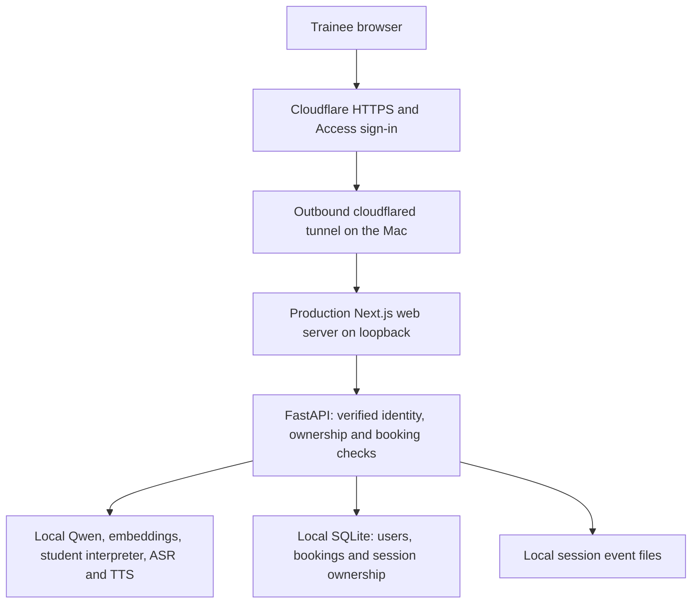

# CascAid: controlled online pilot

Status: stage 1 runtime implemented, 2026-10-16; local validation is recorded below.
Stage 2 code (Access verification and the online profile) implemented, 2026-11-09, and
activated owner-only on 2026-11-10 (record below); some completion checks remain.
Stages 3–6 remain planned. No payment configuration has been deployed. Operational instructions: [production runbook](PRODUCTION-RUNBOOK.md).

Provide remote access to CascAid on a Mac mini over Plusnet broadband, initially
for the owner and then invited trainees. The target is five booked one-hour
sessions daily, with one active trainee at a time. A fixed public IP address is
not required. The first milestone is a working private remote interview, not a
public paid launch.

This extends [the CASC proof of concept](CASC-POC-PLAN.md). Case disclosure,
deterministic feedback, pinned models and honest validation labels remain part of
the product. Internet access does not establish educational or clinical validity.

**Proposed architecture**

Use one hostname, such as `pilot.<owned-domain>`, routing only to the web server.
Keep the existing `/backend` proxy for API requests. API and model ports remain
on loopback; no router port forwarding or dynamic DNS updater is needed.
Configure Access for the whole hostname before making its route available.

Cloudflare documents outbound tunnels without a public IP and identity-protected
applications: [Tunnel overview](https://developers.cloudflare.com/learning-paths/clientless-access/connect-private-applications/)
and [Access setup](https://developers.cloudflare.com/cloudflare-one/access-controls/applications/http-apps/self-hosted-public-app/).

Models and transcript storage remain on the Mac. Remote audio and text transit
Cloudflare, which terminates HTTPS; account identity is also processed there.
Describe this accurately in deployment/privacy documentation rather than claiming
that all data stays on the device. Do not introduce hosted inference, retained
audio, cloud transcript backups or reuse of trainee sessions for training.

**Current repository findings**

| Area | Current behaviour | Required change |
|---|---|---|
| Startup | `scripts/dev/start.mjs` starts Next development mode and Uvicorn reload | Separate production preparation, startup, stop and status workflows |
| Environment | Node loader reads checkout `.env`; Python settings also default there | Explicit production configuration and independent persistent directories |
| Runtime files | Model/speech scripts use `artifacts/m4` and registered ports | Inventory and parameterise deployment paths/ports consistently |
| Identity | Session routes have no user authentication or owner checks | Verified identity and server-enforced ownership |
| Sessions | JSONL event files; session locks and GPU lock are process-local | Keep one API worker; add persistent ownership/admission metadata |
| Booking | No booking system | Transactional slots, reservations and access enforcement |
| Speech | NDJSON response streaming, WAV uploads, generated speech | Test proxy streaming, upload bounds, cancellation and reconnects |
| Timing | Case-specific interview deadlines and 15-second grace | Enforce the booking deadline separately, including queued work |
| Recovery | Development supervisor; no deployment runbook | Supervised production services, recovery and restore rehearsal |

Implement in the following order. Every stage has a concrete completion test.

**1. Prepare an isolated production runtime**

Create `scripts/production/` and configuration examples. Proposed commands are
`production:prepare`, `production:start`, `production:stop` and
`production:status`; these commands are now implemented, together with preflight,
smoke and service-file commands. Preparation installs locked
dependencies, prepares assets and builds the web application. Starting a prepared
release must not download models, update dependencies or rebuild it.

Run `next start` and Uvicorn without reload, with one API worker because the
current locks are in-process. Supervise the web, API and required local model
services, with bounded restart retries, readiness checks and a warm-up before
accepting interviews. Keep version/checksum verification.

Use a separate release directory and service account, with explicit configuration,
session, database, cache, log and state paths. Secrets stay outside source control
with restrictive permissions. Reject missing security configuration and fake
model/speech backends in the online deployment profile. Preserve local development
and fake-backend tests through separate entry points/configuration.

On the existing 16 GB development Mac, initially use mutually exclusive production
and development runtime windows. Changing ports does not isolate GPU load. A
second checkout or account also does not resolve the registered model-port
conflicts: preflight must detect them and stop clearly. Do not run training or
evaluation during remote practice. The same deployment should transfer to a
dedicated Mac later.

Deliver a macOS service configuration and document startup after login/reboot.
Test the chosen service context with Metal, MLX and TTS. Record any FileVault
unlock or user-login requirement; do not promise unattended recovery or enable
automatic login merely to avoid it.

Completion: local production interview and feedback work, no development server
or reload process is running, start/stop only affect owned processes, and missing
models produce an unavailable state rather than false readiness.

**2. Establish owner-only remote access**

Inputs needed when configuring the live service: owned domain/subdomain,
Cloudflare account and DNS control, owner sign-in email, and deployment location.
These do not block preparation of the code and configuration templates.

Create a named tunnel with a catch-all rejection rule. Before enabling its DNS
route, configure Access to allow only the owner. Publish the production web
listener, not the API, model services or development server. Configure a trusted
public origin and host; do not use broad Access bypass rules.

Add API verification of `Cf-Access-Jwt-Assertion`: signature, allowed algorithm,
issuer, audience and token validity. Fetch signing keys only from the configured
Access tenant; use bounded caching/refresh and fail closed when verification is
impossible. Never trust a bare email header. Ensure the Next.js proxy preserves
the assertion. Use the verified issuer/subject as identity and email for display.
See [Cloudflare JWT validation](https://developers.cloudflare.com/cloudflare-one/access-controls/applications/http-apps/authorization-cookie/validating-json/).

Protect all API routes by default; keep minimal health probes loopback-only or
explicitly authenticated. Validate origin/CSRF protection for browser mutations,
bound request bodies while reading them (not just Content-Length), and rate-limit
expensive operations. Disable recording endpoints and public API documentation.
Do not cache authenticated pages, transcripts, feedback or speech responses at
the browser proxy/CDN; static versioned assets may be cached.

Completion: the owner completes a voice station over mobile data; an uninvited
browser cannot access the app or `/backend`; absent, forged, expired and
wrong-audience assertions are rejected. Direct model/API ports are unreachable
externally. The hostname recovers after a broadband reconnect. Emergency shutdown
is demonstrated by disabling the route/tunnel without deleting local data.

**3. Add user and session isolation before inviting trainees**

Add small modules for identity, access metadata and database migrations. SQLite
on local disk is sufficient for this single-host pilot. Store users, roles,
disabled status and session ownership there; retain the existing session events.
Use an internal user ID mapped to verified identity, not client-supplied ownership.

Every session operation must check ownership before reading session data or
starting work: create, read, begin, ordinary/streamed turns, transcription, speech,
interruptions, end and debrief. Authorise streams before sending their first byte.
Apply admission checks again after waiting for the generation lock. Deny access
to legacy sessions without an explicit owner; leave development/research sessions
outside the production data directory.

Define creation/recovery ordering between SQLite and JSONL so a crash cannot make
an unowned session accessible. Use idempotency for retried session creation and
turn submission; reconnecting must not generate duplicate turns or charges.
An administrator may manage bookings without automatically receiving transcript
access. Limit detailed system diagnostics to the administrator while preserving
the Home, Matrix and Status navigation.

Completion: two test identities cannot read, modify, hear or obtain feedback for
each other's sessions, including guessed IDs and direct API requests. Tests cover
disabled users, interrupted creation, retries and restart persistence. Historical
case/prompt/model versions remain recorded and hidden facts remain protected.

**4. Implement five daily bookings and one active interview**

Add slots, bookings, a single active-session lease and an administrative audit log
to SQLite. Use database transactions/constraints so two requests cannot reserve
the same slot. Store timestamps in UTC and publish availability in Europe/London
with explicit timezone display and daylight-saving tests.

Proposed pilot defaults: five 60-minute slots daily, a five-minute buffer between
slots, bookings up to 14 days ahead and free cancellation until the slot starts.
The owner selects the actual daily hours. Five slots plus four buffers require
five hours and twenty minutes of availability. These are configurable operating
defaults, not an already agreed paid cancellation policy.

Provide book, cancel, view-own-bookings and admin block/unblock workflows. Add
booking access from Home; retain the existing primary menu. Begin with free
reservations so payment processing is not a dependency for testing.

Enforce these rules in the API:

- An active booking is required for interview work; browsing and reading one's
  existing feedback can remain available outside it.
- Allow one active station across the deployment, including multiple tabs. A
  request queue alone does not enforce this. Persist/reconcile the lease after a
  restart and bound queue depth and wait time.
- Reject new stations unless their reading time, interview time, existing grace
  and a proposed two-minute response allowance fit before the booking ends.
  Recheck at `/begin` because a trainee can linger on the reading screen.
- Warn at ten and five minutes remaining. At the booking deadline, reject new
  inference and cancel outstanding work; preserve completed turns and make the
  debrief accessible. The next user's allowance must not be consumed by overruns.
- A reconnect resumes the same booking/session. Late arrival does not move the
  deadline. Disabling a user or cancelling a booking revokes further work.
- If readiness fails, prevent new interviews and let the administrator reschedule
  affected bookings. Closing admission must still permit feedback retrieval.

Completion: race tests produce one reservation; early/late/cancelled bookings
cannot invoke models; two tabs cannot start competing stations; deadlines remain
effective across clock changes, queues and restarts; feedback remains private and
readable after expiry. Regenerate API contracts and add component/browser tests.

**5. Rehearse reliability and invite a small pilot group**

Test microphone permission, hands-free mode, interruptions, avatar assets and
sentence streaming through the actual hostname on desktop and mobile browsers.
Compare local and remote timings using the same synthetic questions and pinned
models. Record median/p95 time to first audible reply, complete-turn latency,
failure rate, memory pressure and swap. Do not substitute old grounded-QA
benchmarks for the current full application.

Exercise cold models, long silence, upload limits, Access expiry, network loss,
process crashes, Mac restart and storage exhaustion. Add protocol-compatible
heartbeats and client handling where necessary; keep queue and inference timeouts
bounded. Next.js's current 275-second proxy timeout does not override Cloudflare's
limits. Recheck [connection limits](https://developers.cloudflare.com/fundamentals/reference/connection-limits/)
at deployment and verify streaming is actually delivered without buffering.

Provisional engineering acceptance targets: five consecutive booked hours with
no lost completed sessions, no access-control failures and at least 99% successful
turns during the normal-operation rehearsal, with turn count reported. Target
remote p95 first-audio latency within one second of the measured local baseline
on the test connection; report absolute timings too. These are targets, not
measured claims or proof of a satisfactory learning experience. Fix material
failures and repeat the affected rehearsal before expanding access.

Add bounded logs without audio, transcript text, tokens or sensitive query data.
Proposed retention: delete pilot transcripts/feedback after 30 days or on user
request; keep only necessary administrative metadata separately. Describe the
policy to testers. Back up SQLite and event files consistently to an encrypted
offline/local destination, with a proposed seven-day backup window. Restore in
isolation, reapply deletion records before opening access, and test recovery.

Use wired networking and keep the host awake in availability windows. Rehearse
updates between bookings: drain admission, back up, deploy a pinned release,
check readiness, then reopen. Maintain the previous release and a database-aware
rollback procedure; a schema downgrade must not destroy newer session data.

Completion: documented remote rehearsal, successful restore, known limitations,
working emergency stop, and an operator runbook. Invite 5–10 testers only after
stages 1–4 pass. Measure useful station throughput and repeat interest as well as
technical latency. Move booked use to a dedicated host before relying on regular
availability while the current Mac remains a development machine.

**6. Optional paid pilot, after the private pilot**

Treat payments as a separate release. Add checkout, receipts, cancellations,
refund/replacement-credit handling and transparent experimental-product wording.
Validate pricing through the pilot rather than assuming full occupancy or proven
exam benefit. Check distribution/use permissions for deployed model and avatar
assets as part of packaging the paid service.

If Stripe is chosen, use signed, idempotently processed webhooks and atomic
expiring reservation holds. Never grant access from a browser's success redirect.
Only the exact signed webhook endpoint may bypass interactive Access; all other
API paths stay protected. Handle delayed/duplicate events, hold expiry and refunds
without double-booking. No payment setup or charges are part of the current plan
creation task. Implementation must consult current payment-provider documentation.

Completion: sandbox payment/retry/refund tests pass; paid bookings grant exactly
the purchased entitlement; downtime handling is documented. Report realised price,
occupancy, support time, refunds and infrastructure costs separately from profit.

**Work packages and validation**

| Order | Main implementation locations | Required evidence |
|---|---|---|
| 1 | `scripts/production/`, runtime helpers, settings, configuration examples | Production smoke test, preflight and owned-process shutdown tests |
| 2 | Access verifier, API boundary, web proxy, tunnel/service templates | Identity rejection tests and owner-only external interview |
| 3 | SQLite migrations, access service, session routes/store | Cross-user tests for every session endpoint and crash recovery |
| 4 | Booking domain/routes, Home/booking UI, generated API types | Reservation races, admission, deadline and timezone tests |
| 5 | Deployment runbook, retention/backup scripts, remote smoke harness | Five-hour rehearsal, deletion/restore and rollback evidence |
| 6 | Payment adapter, webhook, checkout UI | Sandbox entitlement and refund tests |

For code stages, run the applicable API and web tests, lint/type checks, generated
contract checks, production build and browser tests. Record unrelated baseline
failures separately and establish whether any affect the deployment. Never call
a release verified while omitting a relevant failing check. This documentation-only
change does not claim to have executed these future checks.

**Stage 1 implementation and validation record (2026-10-16)**

- Separate immutable release snapshots and private configuration, sessions, cache,
  logs and runtime state. Preparation uses offline npm/uv caches and a production
  Next build; startup does not install or download anything.
- One Uvicorn worker without reload, production Next startup, registered local
  models, speech services, classifier preparation and synthetic warm-up before
  opening the web listener. Two automatic restart attempts; transient health
  timeouts require three consecutive failures, process exits are detected directly.
- Private socket-based stop/status and owned process-group cleanup. Busy ports,
  fake backends, unsupported online profiles, changed release inputs and missing
  model assets fail closed. Development entry points retain their previous defaults.
- macOS LaunchAgent configuration generated and successfully rehearsed in the
  current signed-in account. It was unloaded after testing; no login-persistent
  service or dedicated service account was installed. Final-host account setup,
  FileVault/login and reboot recovery remain explicit operator tasks in the runbook.
- Local synthetic interview, speech synthesis, ASR and feedback passed, including
  the web proxy. Home, Matrix and Status loaded in a headless browser. Warm-up
  session files were removed. The initial classifier cache was built separately
  from development and is retained for subsequent starts.
- A deliberate production TTS shutdown closed the web listener, restarted the
  owned stack once and returned to full readiness. Both foreground operation from
  the prepared release and macOS LaunchAgent startup were exercised. Graceful stop
  released the ports; production does not signal unrelated development processes.
- Deployment tests: 10 passed. API suite: 272 passed, 1 existing training/evaluation
  near-copy failure (393 matches in the current data). No training/evaluation data
  were changed by this stage. This affects evaluation independence, not the
  production launcher; it remains unresolved and prevents claiming an entirely
  green repository suite. Web tests: 63 passed. API lint, generated contracts and
  production build/TypeScript checks passed.

The next application stage is owner-only authenticated access (stage 2). Prepare
the Access verifier locally before configuring a live hostname. Domain/account
inputs are needed to activate the external route, not to prepare its implementation.

**Stage 2 code record (2026-11-09)**

- `production-online` profile in the production configuration and API settings. It
  requires the Access team domain, application audience, allowed emails and public
  origin, and keeps the stage 1 rules (local models, loopback endpoints, no recording).
  Incomplete or malformed values stop startup.
- `psychiatry_api.access`: RS256 verification of `Cf-Access-Jwt-Assertion` (issuer,
  audience, expiry, not-before, subject), an email allowlist, bounded key caching with
  rate-limited refresh, and 503 when keys cannot be obtained. Origin checks on
  state-changing requests, bodies counted while read, per-identity rate limit,
  `no-store` responses. No docs or recording routes.
- The web proxy forwards `/backend/api/*` only and refuses requests carrying the
  supervisor's internal header. Supervisor readiness now uses the API's loopback probe
  plus the web home page. A per-start secret, held only by the API processes and a
  private state file, admits warm-up and smoke requests.
- Tests: 44 new API test cases (absent, malformed, forged, expired, not-yet-valid,
  wrong-audience, wrong-issuer, HS256/none and unknown-key assertions; unlisted
  emails and service tokens; key outage and refresh limits; probes; internal secret;
  origin; streamed and declared body limits; rate limit; hidden docs; settings) and 2
  deployment tests. API suite 345 passed, deployment 12, web 63, e2e 6 passed with 1
  speech test skipped (no local ASR running). Lint, types and contracts passed.
- A production Next build was run against a header-echo stand-in for the API. The
  assertion and Origin headers were forwarded. `/backend/ready`, `/backend/health` and
  `/backend/docs` returned 404, as did requests carrying the internal header. NDJSON
  streamed incrementally, and pages and API responses were `no-store`.
- Not yet done: a live tunnel, Access application, real Cloudflare-issued tokens, a
  full `production:start` in the online profile on this Mac, and the stage 2
  completion checks in the runbook.

**Stage 2 activation record (2026-11-10)**

- Owner-only Access application (one-time PIN, single allowed email) on a Cloudflare
  team; locally managed tunnel `cascaid` (cloudflared 2026.10.7, checksum and Cloudflare
  Developer ID signature verified) routing one hostname to `127.0.0.1:3105`, with
  cloudflared's own Access check enabled and a catch-all 404 rule. No router port
  forwarding.
- Release `online-001` prepared and passed preflight; startup warm-up, `production:status`
  and `production:smoke` passed (interview, local generation, speech, transcription,
  feedback). No CascAid listener outside loopback.
- Locally refused: a forged assertion on the API and web proxy (401), a bare email
  header (401), the internal secret sent through the proxy (404), `/backend/ready` (404),
  API docs (401). Publicly, every path without a sign-in redirected to the Access login,
  including requests with a forged assertion.
- The owner signed in remotely and confirmed a working station.
- Outstanding: an explicit mobile-data voice station with feedback; an uninvited email
  test; an external port check; recovery after a broadband reconnect; demonstrated
  emergency shutdown; and login-persistent services (supervisor LaunchAgent and
  `cloudflared service install`). The tunnel and supervisor currently run in a terminal
  session.
