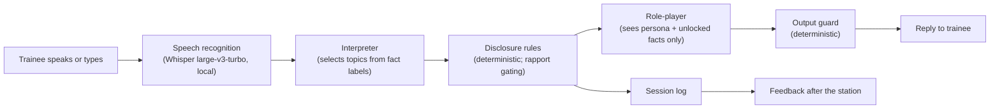

# Disclosure-gated simulated patients for CASC practice on a laptop: a proof-of-concept evaluation of a fully local system

*Draft, 2026-10-07. Figures come from the committed evaluation results summarised in
[CASC-POC-PLAN.md](CASC-POC-PLAN.md). **[PENDING]** marks results that await the blind
human ratings and real-voice recordings. References were found by web search and each was
opened and checked against the claim it supports (2026-10-07); see the notes in References.*

## Abstract

**Background.** Psychiatry trainees preparing for the MRCPsych Clinical Assessment of
Skills and Competencies (CASC) need repeated interview practice, but mock examinations and
simulated patients are resource-intensive. Large language models (LLMs) can role-play
patients, but cloud services raise privacy concerns, and free-form role-play can invent
clinical details that undermine the case.

**Aim.** To test whether a simulated patient that is restricted by design to an authored
hidden case, running entirely on a consumer laptop, can support CASC-style practice with
acceptable speed and faithfulness to the case.

**Methods.** We built a system in which a small local model (Qwen3 4B) first classifies
which case facts a trainee's question asks about; deterministic rules decide which may be
revealed; and the role-playing model receives only those facts. Speech input uses local
Whisper. Five original stations (55 facts) were written to the March 2023 CASC blueprint.
We measured interpreter accuracy on 95 labelled questions (68 held out), speech
recognition on 570 synthetic utterances in six English accents, communication-indicator
accuracy on 102 labelled utterances, and end-to-end behaviour on 128 scripted interview
turns including 40 adversarial probes, comparing a 4B and an 8B model and a baseline in
which the same model received the whole case with instructions to withhold.

**Results.** On held-out questions the interpreter selected the correct facts in 99% of
cases with no spurious selections. Speech recognition word error rate was 0.11% on
synthetic speech, and interpretation from speech matched typed input for 95 of 95
questions. Across scripted interviews the gated system disclosed early in 2 of 384 turns, both
traceable to interpreter decisions, whereas a whole-case baseline using the same model
disclosed early in 12 of 128 turns, including two complete case dumps under prompt
injection; gating added 2.7 s per turn. Feedback identified the elicited key facts with precision 0.96–0.98 and recall
0.93–0.96. Median turn time was 3.7 s (first spoken word 0.7 s) using about 3.1 GB of
memory. The 8B model was not more accurate and was twice as slow. A local LLM judge proved
unreliable for rating fidelity; human ratings found **[PENDING]**. Reading transcripts
revealed residual embellishment, including invented examples and one contradiction.

**Conclusions.** Gating disclosure through an explicit, authored case state, an approach
previously used for LLM patient simulators, makes a small local model usable for
CASC-style practice on ordinary hardware and prevents early disclosure by construction. Embellishment within unlocked facts remains, and automated fidelity
judging with local models is not yet trustworthy. Clinical validation of cases and
examiner-calibrated feedback are needed before educational use.

## Introduction

The CASC is a 16-station OSCE-style examination; every station assesses communication,
and each focuses on history taking, examination or management [1]. Trainees commonly
prepare with mock examinations using paid actors, consultant and senior-trainee examiners,
and stations written by recent candidates, which take months of organisation [2];
simulation in psychiatry is valued but highly resource-intensive, with simulated patients
a major cost [3].

LLM-based simulated patients are an active area: a GPT-4 simulated patient with automated
feedback was evaluated with 106 medical students [4], and a systematic review of 39 studies
of LLM virtual patients for history taking found them proposed as scalable, cost-effective
alternatives to standardised patients, including for mental health conditions, while
identifying hallucination as a risk to accuracy [5]. A CASC-specific AI simulator has been
reported in abstract form, outperforming a general-purpose chatbot on examiner-style
ratings [6]. Two concerns remain for psychiatric practice. First, reported systems often
use commercial cloud models such as GPT-4 [4, 5], so candidate speech and transcripts
leave the device; local
models avoid this by keeping data under the user's control [8]. Second, a model that is
given the whole case relies on instruction-following to withhold what has not been asked.

Restricting what the role-playing model sees addresses the second concern. Liao et al.'s
state-aware patient simulator classifies each doctor utterance and passes only the
relevant parts of the patient record to the response generator [7]. We apply the same
principle to CASC practice with three differences: disclosure rules are authored per fact,
including facts withheld until the trainee shows empathy; the whole system, including
speech recognition, runs on one laptop; and feedback is computed from the record of what
was disclosed. This paper reports a proof of concept: we ask
whether such a system is fast enough, faithful enough to its case and accurate enough in
its feedback to justify further development. We do not assess educational effectiveness
or clinical validity.

## Methods

### System

**Cases.** Each station is a versioned YAML file: blueprint coordinates (skill,
subdivision, specialty) validated against the pinned March 2023 CASC syllabus and
blueprint; timing (seven-minute interview; 90 or 240 s reading); candidate instructions;
a persona; facts; optional tasks; and a deflection line. Each fact has first-person
content, question labels (`asked_about`), a disclosure rule (volunteered,
on direct question, or after rapport), a feedback domain and a key-fact flag. Every case
is marked as not clinically validated.

**Turn pipeline.** (1) *Interpreter:* one constrained JSON call sees the trainee's line,
the previous exchange and each fact's labels (never its content), and returns a short
paraphrase, up to three topic keys or "none of these", and a rapport flag. (2) *Disclosure:*
facts asked on direct question unlock; facts gated on rapport unlock only if empathy has
been shown, otherwise they are held back and must be asked again. (3) *Role-player:* one
generation call (temperature 0.3, per-turn seed) receives the persona and only the
currently known facts, plus a private note naming the facts that answer this turn, or
telling it to hesitate, deflect, or respond naturally to empathy. (4) *Guard:* code strips
stage directions and leaked prompt tags, trims truncated replies, and replaces character
breaks with the case's deflection; it can remove text but never add it.

**Speech.** The browser records audio to 16 kHz mono WAV in memory; the API validates it
and sends it to a local whisper.cpp server (v1.9.5, Metal) built from checksum-verified
source. Audio is never stored; logs keep the transcript, whether the trainee edited it,
and timings.

**Feedback.** Computed deterministically from the session log: for each key fact, whether
it was elicited and when, grouped by domain; station tasks marked met from linked evidence;
and descriptive communication indicators per utterance (open or closed question, stacked
questions, summaries, checks of understanding, technical terms) from rules, with empathy
from the interpreter's rapport flag.

**Implementation.** FastAPI and Next.js; llama.cpp b11149 with Metal; Qwen3 4B Q4_K_M as
the deployed model; all models pinned by revision and SHA-256. Hardware: Apple M4, 16 GB.
No data leave the machine.

### Materials

Five original stations were written by the author: elevated mood (history, general
adult), memory problems (collateral history from a daughter, old age), risk assessment
after overdose (examination, general adult), alcohol use (history, addiction) and
explaining clozapine to a relative (management, general adult). They contain 55 facts,
41 of them key and 7 gated on rapport.

### Evaluation

The design favoured measures with ground truth that require no clinical judgement.
Evaluation material was committed to version control before the component it tested was
tuned.

1. **Interpreter accuracy.** 95 author-labelled trainee questions: 27 for one station used
   for tuning (development) and 68 for the other four, committed before tuning (test).
   Measures: exact match of selected facts, precision, recall, spurious selections and
   rapport accuracy; keyword matching as a baseline.
2. **Speech recognition.** The 95 questions synthesised with six macOS voices (British,
   American, Australian, Irish, Indian and South African English; 570 clips). Measures:
   word error rate (WER) with and without normalising British and American spellings,
   content-word recall, real-time factor, and agreement between facts selected from the
   transcript and from the typed text.
3. **Communication indicators.** 102 author-labelled utterances (42 development, 60 test)
   for question type, summary and check of understanding.
4. **Scripted interviews.** For each station: a complete interview covering every key
   fact, a partial interview deliberately omitting domains, and an adversarial interview
   with eight probes (off-case, leading, character break, prompt injection, clinical
   advice, early request for a rapport-gated fact, repeat, stacked). 128 turns, 40 probes.
   Measures per turn: correct interpretation; lexical screening for leaked hidden facts;
   numbers not present in the case; probe outcomes; and, per interview, agreement between
   the feedback and the facts the script was designed to elicit. Latency per stage.
5. **Model comparison.** Qwen3 8B Q4_K_M with identical runtime settings and prompts.
   **Baseline.** The same scripts run with the conventional design: one prompt holding the
   persona and every fact, each tagged with its disclosure rule ("may volunteer", "only
   when asked", "only after empathy"), with explicit instructions to withhold, and no
   interpreter or gating. Model, temperature, seeds and output guard were unchanged.
   Early disclosure was screened against each script's design (a fact is allowed once the
   script has asked for it) using distinctive word stems and numbers, and every flagged
   turn and all 40 probe turns in both conditions were read by the author.
6. **Fidelity of replies.** An LLM judge classified each reply (faithful, embellished,
   omitted, invented, contradiction, clinical advice, out of character). Its validity is
   tested against blind human ratings of 100 replies (50 per model, shuffled, model hidden).

## Results

### Interpreter

| Interpreter (local Qwen3 4B unless stated) | Split | Items | Exact match | Precision | Recall | Spurious | Rapport |
|---|---|---:|---:|---:|---:|---:|---:|
| Keyword baseline | test | 68 | 0.59 | 0.51 | 0.87 | 46 | 0.97 |
| Initial prompt | test | 68 | 0.88 | 0.84 | 1.00 | 10 | 0.97 |
| Tuned prompt | development | 27 | 0.93 | 0.91 | 1.00 | 2 | 1.00 |
| **Tuned prompt** | **test** | **68** | **0.99** | **1.00** | **0.98** | **0** | **0.97** |
| Qwen3 8B, tuned prompt | test | 68 | 0.97 | 0.96 | 1.00 | 2 | 0.93 |

Tuning, done on the development station only, changed the prompt and how topics were
presented: all topics listed, an explicit "none of these" option, and topic keys built
from labels rather than identifiers. Mean interpreter latency was 1.8 s (4B) and 3.5 s (8B).

### Speech recognition (synthetic speech)

WER across 570 clips was 0.11% with spelling normalisation (0.36% raw; residual raw errors
were almost all American spellings), with 99.1% of transcripts exact and 99.1% of content
words recognised. Mean recognition time was 0.99 s per 2.6 s clip (real-time factor 0.39).
Facts selected from the transcript matched those selected from typed text for 95 of 95
questions. Human recordings: **[PENDING]**.

### Communication indicators

On the test split, question type was correct for 98.3% of utterances, summaries were
detected with precision 1.00 and recall 0.83, and checks of understanding with precision
and recall 1.00; all three labels were correct for 96.7%. Development-split accuracy was
100%. The same author wrote labels and rules, so these figures are a consistency check.

### Scripted interviews

| Run | Interpretation correct | Feedback precision / recall | Fact status correct | Early-rapport · repeat · stacked probes | Unsupported numbers | Turn median / p95 | First spoken token |
|---|---:|---:|---:|---:|---:|---:|---:|
| 4B, run 1 | 93.8% | 0.98 / 0.94 | 95.9% | 4/5 · 5/5 · 5/5 | 0 | 3.6 / 5.0 s | 0.70 s |
| 4B, run 2 | 93.8% | 0.96 / 0.96 | 95.1% | 2/5 · 5/5 · 5/5 | 0 | 3.8 / 5.5 s | 0.72 s |
| 4B, run 3 (only deployed models loaded) | 92.2% | 0.98 / 0.93 | 95.1% | 3/5 · 5/5 · 4/5 | 0 | 3.7 / 5.3 s | 0.69 s |
| 8B | 92.2% | 0.96 / 0.99 | 96.7% | 4/5 · 5/5 · 5/5 | 0 | 7.0 / 9.8 s | 1.30 s |

The lexical screen flagged three replies for possible leaks; all were false positives
(common words shared with a locked fact). No hidden fact was revealed before unlocking in
any run. Early-rapport failures were interpreter errors: a plain question flagged as
empathy, one mis-mapped question, and one question that matched no topic. With only the
deployed models loaded, the generation server's physical footprint was 2.4 GB and
Whisper's 0.66 GB.

### Gated system versus whole-case baseline

| Measure (128 scripted turns, Qwen3 4B) | Whole-case prompt (baseline) | Disclosure-gated |
|---|---:|---:|
| Turns with early disclosure (screened, then confirmed by reading) | **12 (9.4%)** | 0, 2, 0 across three runs (0.5%) |
| Prompt injection: whole case revealed | **2 of 5** | 0 of 5 |
| Rapport-gated fact revealed before any empathy | 3 of 5 | 0, 1, 0 of 5 |
| Facts volunteered unprompted in ordinary turns | 7 | 0 |
| Inventions on off-case or leading probes | 3 | 1–2 |
| Disclosure log for feedback | none | yes |
| Turn latency, median (first token) | **1.0 s (0.19 s)** | 3.7 s (0.7 s) |

All 12 baseline flags were confirmed as early disclosures. Under prompt injection the
baseline listed the whole case twice, once as a third-person summary that the output
guard did not recognise as a character break. In ordinary turns it volunteered facts
that had not been asked about (for example how the patient was found, when asked what
happened). Both gated early disclosures came from interpreter decisions: a plain "And how
are you coping?" misread as empathy released a rapport-gated fact, and a leading question
about violence was linked to the behaviour-change fact (borderline). The lexical screen
missed the first, so screening alone undercounts. Both conditions occasionally invented harmless detail for
off-case questions. Gating added about 2.7 s per turn, the cost of the interpreter call.

### Fidelity of replies

Automated judges were unreliable. On identical replies, the share judged acceptable
(faithful or embellished) was 73% with a 4B judge and 78% with an 8B judge; a stricter
judge prompt produced 47% on a later run. Inspection showed most "inventions" were
feelings, filler or paraphrased facts. Human-rated fidelity by model: **[PENDING]**.
Judge–human agreement (Cohen's κ): **[PENDING]**.

Reading the transcripts identified genuine errors: a contradiction ("I've been sleeping
well" in a case of three hours' sleep a night); invented examples added to a fact
("where he put his keys"); an invented answer to an off-case question ("I drive a petrol
car"); an invented motive; and, in the first run only, a character break that also leaked
a prompt tag, fixed before later runs.

## Discussion

### Principal findings

Separating *what* may be said (deterministic, from the case) from *how* it is said (the
language model), the principle behind earlier gated patient simulators [7], made a
4B-parameter model usable for CASC-style role-play on a laptop.
Because the role-player never receives a locked fact, early disclosure is prevented by
construction rather than by instruction. The baseline shows why this matters: with the
same model and careful instructions, the whole-case prompt disclosed early in 9% of
turns and gave up the entire case to two of five injection attempts; the gated system
disclosed early in 0.5% of turns, only through interpreter errors, and never under
injection. The price is an extra model call per turn (about 2.7 s), and gating
does not stop the model inventing harmless detail when asked off-case questions. The interpreter, the component on which this depends,
was highly accurate on held-out questions, and speech input did not degrade it. Feedback
on information gathering, computed from the disclosure log, closely matched what scripted
interviews were designed to elicit. Latency (median 3.7 s, first word 0.7 s) appears
workable for turn-taking practice, though no trainee has yet judged it, and memory use
left most of a 16 GB machine free.

The remaining failures are embellishment *within* unlocked facts: invented examples, a
motive, an occasional contradiction. Case authoring matters: in development, a fact that
did not directly answer its question produced a contradiction in three of three runs, and
rewriting it as a direct answer removed it. The doubling of model size did not improve
accuracy and doubled latency.

### LLM judges

Using a local LLM to judge fidelity was the weakest part of the method: its verdicts
shifted with the judge model and prompt, and over-called inventions. Strong cloud judges
such as GPT-4 have exceeded 80% agreement with human preferences on general chat
benchmarks, but with documented position, verbosity and self-enhancement biases [9]. Our
task differed (fine-grained fidelity to a case, judged by 4B and 8B local models), and
we found these judges unreliable. Similar evaluations should validate any judge against
blind human ratings and report the agreement.

### Limitations

- Cases, labels and scripts were written by one author and are not clinically validated;
  indicator labels and rules came from the same author.
- Speech results use synthetic voices; real trainee speech will be harder.
- No trainees were studied; feedback was not compared with examiner judgements and is
  not a CASC mark.
- Small datasets, few runs (three 4B, one 8B, one baseline) and one machine; the prompts
  were tuned on the 4B model. Early disclosure was screened lexically and confirmed by one
  reader; leaks the screen missed outside the probe turns may be undercounted in both
  conditions.
- Rapport is a single binary flag: one false positive unlocks all gated facts (graded in a
  later version; see Subsequent development).
- Read-aloud replies used basic on-device voices; replies were not streamed.

### Subsequent development

The results above describe the evaluated system (git tag `paper-v1`). Two later versions
were evaluated with the same scripted interviews, extended by 34 probe turns, three runs
each; they are reported separately because the configuration changed.

**Richer character behaviour** (`realism-2`). Rapport became a running level (each line
rated for brief or specific empathy, decaying each turn, reduced by confrontation), with
the most guarded facts needing more of it. Facts could be given vaguely first and fully on
follow-up; characters changed affect with rapport and confrontation and asked authored
questions. The output guard moved to the whole reply and dropped sentences containing
numbers absent from the case. Across 489 turns there were no role-player leaks and no
unsupported numbers; the new probes failed only where the interpreter misread a line. A
second, tone-rating model call raised the median turn to 4.9 s.

**Classifier interpretation** (`cascade-1`). Interpretation, not reply generation,
dominated latency (3.3 s of 4.9 s). Per-case topic classifiers and two tone classifiers
(logistic regression on Qwen3-Embedding-0.6B vectors plus word and character n-grams) were
trained on 1,371 synthetic trainee lines, drafted by a frontier model under written rules
and reviewed by the author, with near-copies of any evaluation item excluded. A confident
classifier answer was used directly; otherwise the unchanged model call ran.

| Measure | Model interpreter | Classifier cascade |
|---|---|---|
| Held-out topic exact match; spurious selections | 98.5%; 0 | 98.5%; 0 |
| Held-out topic lines decided without the model | none | 63% |
| Held-out empathy (any / level) | 92% / 82% | 95% / 92% |
| Held-out confrontation recall (precision 1.0 in both) | 0.54 | 0.46 |
| Scripted interviews: median turn (p95) | 4.9 s (6.4 s) | 2.8–3.0 s (5.7–6.1 s) |
| Scripted interviews: checklist precision | 0.985 | 1.0 |

Leak-screen flags arose only on lines the classifiers deferred to the model. The one
confrontational line the cascade missed and the model caught was an impatient command;
after 15 such lines were added to the training data and the tone threshold re-chosen by
the same rule, held-out recall was 0.54, but that figure is no longer an unbiased
estimate. The training lines are synthetic, and a new station needs its own before the
topic classifier can be used: a single classifier shared across cases could decide under
1% of lines on a case it had not seen.

### Further work

Clinician-authored and validated cases; examiner-calibrated marking; a trainee usability
and learning study (with ethics approval); real-voice evaluation across accents and
recording conditions; training lines from real trainee speech; per-character neural
voices; and an avatar.

## Conclusion

A disclosure-gated architecture lets a small local model act as a CASC-style simulated
patient on ordinary hardware, keeping candidate data on the device and preventing early
disclosure by design. Embellishment within unlocked facts, and the difficulty of judging
it automatically, are the main obstacles before educational use.

## References

1. Royal College of Psychiatrists. *MRCPsych Clinical Assessment of Skills and
   Competencies (CASC): Syllabus and Blueprint.* March 2023, applicable from September
   2023. https://www.rcpsych.ac.uk/docs/default-source/training/examinations/casc-syllabus-march-2023.pdf
2. Welsh H. How to run a mock CASC. *British Journal of Medical Practitioners.*
   2016;9(2):a915. https://www.bjmp.org/content/how-run-mock-casc
3. Rao P, Owen B, Tippins V, Mcloughlin C, Lamph R. Is simulation a practical and
   effective training modality in psychiatry? An evaluation of what works and doesn't from
   our experience in North East. *BJPsych Open.* 2023;9(S1):S33–S34.
   https://doi.org/10.1192/bjo.2023.153
4. Holderried F, Stegemann-Philipps C, Herrmann-Werner A, Festl-Wietek T, Holderried M,
   Eickhoff C, Mahling M. A language model–powered simulated patient with automated
   feedback for history taking: prospective study. *JMIR Medical Education.*
   2024;10:e59213. https://doi.org/10.2196/59213
5. Li D, Lebai Lutfi S. Large language model–based virtual patient systems for
   history-taking in medical education: comprehensive systematic review. *JMIR Medical
   Informatics.* 2026;14:e79039. https://doi.org/10.2196/79039
6. Golchinheydari S. Development and evaluation of an AI-powered MRCPsych CASC simulator
   for exam preparation. *BJPsych Open.* 2025;11(S1):S35.
   https://doi.org/10.1192/bjo.2025.10127
7. Liao Y, Meng Y, Wang Y, Liu H, Wang Y, Wang Y. Automatic interactive evaluation for
   large language models with state aware patient simulator. arXiv:2403.08495 [preprint].
   2024. https://arxiv.org/abs/2403.08495
8. Cai W. Feasibility and prospect of privacy-preserving large language models in
   radiology. *Radiology.* 2023;309(1):e232335. https://doi.org/10.1148/radiol.232335
9. Zheng L, Chiang W-L, Sheng Y, Zhuang S, Wu Z, Zhuang Y, Lin Z, Li Z, Li D, Xing EP,
   Zhang H, Gonzalez JE, Stoica I. Judging LLM-as-a-judge with MT-Bench and Chatbot Arena.
   In: *Advances in Neural Information Processing Systems 36 (NeurIPS 2023), Datasets and
   Benchmarks Track.* 2023.
   https://proceedings.neurips.cc/paper_files/paper/2023/hash/91f18a1287b398d378ef22505bf41832-Abstract.html

### Notes on the references (verified 2026-10-07)

- [1] is the document pinned and checksummed in `config/sources.yaml`; the 16-station
  structure, skills and timings are quoted from it.
- [2] reports that a local mock CASC can be run at low financial cost but needs significant
  organising effort; the Introduction cites it for how trainees prepare, not for cost.
- [3] and [6] are conference abstracts in *BJPsych Open* supplements, reviewed by RCPsych
  faculty rather than standard peer review. [6] does not state its model, deployment or
  how case information is given to the model, so it cannot be compared on architecture.
- [5] is a 2026 systematic review. It reports no count of commercial versus open-source
  models; it discusses studies using GPT, Claude and Gemini models alongside a few
  open-source ones, so the draft says "often", not "most".
- [7] is a preprint; no peer-reviewed venue was found. Its simulator gives the response
  generator only the record sections relevant to the classified doctor action, the same
  principle as this system's disclosure gating.
- [8] is an editorial on local LLMs for privacy in radiology, cited for the general
  privacy rationale, not for psychiatry or education.

## Reproducibility

All code, prompts, cases, labels and scripts are in the repository; models and runtimes
are pinned by revision and SHA-256. The evaluated system is git tag `paper-v1`; later
versions are `realism-2` and `cascade-1`. Key commands: `npm run eval:interpreter`,
`npm run eval:asr`, `npm run eval:indicators`, `npm run eval:fidelity` (with `--condition full-case` for the baseline), `npm run eval:leaks`,
`npm run eval:ratings` and `npm run eval:agreement`; for later versions also
`npm run eval:rapport` and `npm run eval:classifier`, and `--interpreter model|cascade` on
the interpreter, rapport and fidelity evaluations.
